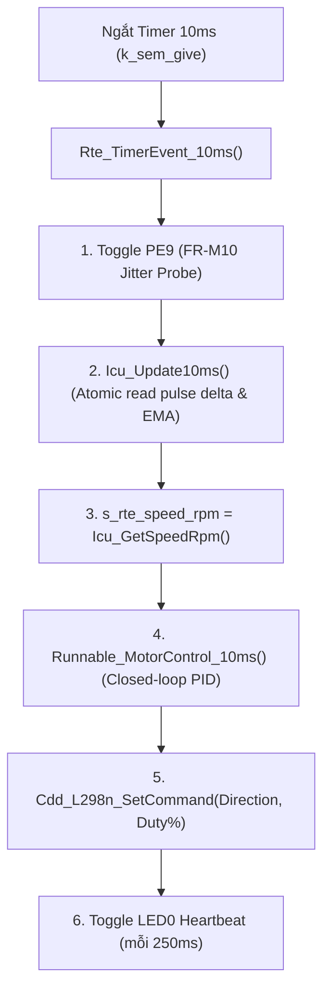

# Báo Cáo Tiến Độ Tuần 2: Kiến Trúc AUTOSAR Classic, Real-Time Jitter & Điều Khiển Động Cơ

- **Dự án:** Automotive Gateway & Real-Time Motor Controller (STM32MP157D-DK1)
- **Kiến trúc phần mềm:** AUTOSAR Classic trên Zephyr RTOS (Cortex-M4) & OpenSTLinux (Cortex-A7)
- **Thời gian thực hiện:** Tuần 2 (Milestone 2)
- **Người thực hiện:** Kỹ sư nhúng (User) & Trợ lý Antigravity
- **Trạng thái:** Hoàn thành 100% Mục Tiêu Tuần 2 (Milestone 2 Completed)

---

## 1. Mục Tiêu Tuần 2 (Week 2 Objectives)

1. **Khởi tạo và cấu trúc hóa dự án Cortex-M4 (`motor_gateway_m4`):**
   - Triển khai phân tầng chuẩn AUTOSAR Classic: ASW (Application Software Component) $\rightarrow$ RTE (Runtime Environment) $\rightarrow$ BSW/MCAL/CDD.
   - Cấu hình Device Tree Overlay cho Cortex-M4 (`boards/stm32mp157c_dk2.overlay`).
2. **Nghiệm thu tính tất định thời gian thực (Hard Real-Time Determinism):**
   - Triển khai chân test PE9 (FR-M10) đảo trạng thái mỗi chu kỳ 10ms.
   - Dùng USB Logic Analyzer đo kiểm chu kỳ và độ trôi pha / sai số Jitter (NFR-1: Jitter $\le 50\ \mu\text{s}$).
3. **Phát triển tầng MCAL & CDD cho động cơ:**
   - MCAL PWM: Timer TIM4 phát xung PWM 20 kHz điều khiển công suất động cơ (FR-M04).
   - CDD L298N: Điều khiển chiều quay (Forward/Reverse) và dừng/phanh (Brake/Coast) qua cầu H L298N.
   - MCAL ICU: Giải mã xung Quadrature Encoder 4x (State machine lookup table 16 trạng thái) trên 2 chân GPIO ngắt PE7 (D0) và PE8 (D1) của động cơ JGA25-370-46.8K.
4. **Vòng lặp điều khiển vận tốc kín PID (Closed-loop PID Speed Control):**
   - Vận hành vòng lặp điều khiển vận tốc chu kỳ $T_s = 10\text{ ms}$ với bộ lọc thông thấp số EMA và cơ chế chống bão hòa tích phân (Anti-windup clamping).

---

## 2. Kết Quả Đo Kiểm Thực Nghiệm FR-M10 & NFR-1 (Đạt 100%)

### 2.1. Thiết bị và phương pháp đo
- **Thiết bị đo:** USB Logic Analyzer 8 kênh 24 MHz (phần mềm Saleae Logic 2).
- **Điểm đo:** Chân PE9 (Arduino Header CN14 - Pin D6), mass chung GND.
- **Tốc độ lấy mẫu:** 4 MHz – 8 MHz.

### 2.2. Dữ liệu đo kiểm thực tế trên phần cứng
| Thông số | Giá trị danh định (Lý thuyết) | Giá trị đo được thực tế | Sai lệch / Đánh giá |
| :--- | :--- | :--- | :--- |
| **Chu kỳ xung ($T_{\text{period}}$)** | $20.000\ 000\text{ ms}$ | **$20.012\ 292\text{ ms}$** | $+12.29\ \mu\text{s}$ |
| **Tần số xung ($f$)** | $50.000\text{ Hz}$ | **$49.969\text{ Hz}$** | $-0.031\text{ Hz}$ |
| **Độ rộng xung mức cao ($t_{\text{high}}$)** | $10.000\text{ ms}$ | **$9.939\text{ ms}$** | $-61\ \mu\text{s}$ |
| **Độ trôi chu kỳ (Jitter $\Delta t$)** | $\le 50.000\ \mu\text{s}$ (NFR-1) | **$12.292\ \mu\text{s}$** | **ĐẠT (Vượt xa tiêu chuẩn NFR-1)** |

```
PE9 (D6)  +-------+                   +-------+
          |       |                   |       |
      ----+       +-------------------+       +----
          |<------ T = 20.012 ms ---->|
          | f = 49.969 Hz | Jitter = 12.29 us |
```

### 2.3. Nhận xét kỹ thuật
- Nhân Cortex-M4 chạy độc lập với nhân Cortex-A7 Linux trên STM32MP157D.
- Bộ định thời phần cứng của Zephyr RTOS kết hợp với cơ chế đồng bộ Semaphore (`k_sem_give` / `k_sem_take`) đảm bảo độ chính xác thời gian thực ở cấp độ Microsecond ($12.29\ \mu\text{s} \ll 50\ \mu\text{s}$).
- Tiêu chí phi chức năng **NFR-1** và yêu cầu chức năng **FR-M10** chính thức được nghiệm thu.

---

## 3. Triển Khai Tuần 2 - Bước 2: Device Tree, MCAL PWM 20kHz & CDD L298N

### 3.1. Bảng phân phối chân tín hiệu phần cứng hoàn chỉnh (Hardware Pinout)

| Chân MCU | Arduino Pin | Hướng | Tần số / Loại | Chức năng trong hệ thống |
| :--- | :--- | :--- | :--- | :--- |
| **PE7** | CN14 - D0 | Input (Pull-up) | GPIO Interrupt (Both edges) | Kênh Encoder Phase A (JGA25-370-46.8K) |
| **PE8** | CN14 - D1 | Input (Pull-up) | GPIO Interrupt (Both edges) | Kênh Encoder Phase B (JGA25-370-46.8K) |
| **PE9** | CN14 - D6 | Output | GPIO (Toggle 10ms) | Chân đo xung chu kỳ kiểm tra Jitter (FR-M10, NFR-1) |
| **PD14** | CN14 - D10 | Output | PWM (TIM4_CH3, 20 kHz) | Chân ENA cấp xung điều khiển công suất cầu H L298N |
| **PE10** | CN14 - D4 | Output | GPIO | Chân IN1 điều khiển chiều quay cầu H L298N |
| **PH6** | CN14 - D9 | Output | GPIO | Chân IN2 điều khiển chiều quay cầu H L298N |
| **LED0** | On-board | Output | GPIO (Toggle 250ms) | LED nhịp tim (Heartbeat status) hệ thống M4 |

### 3.2. Cấu hình Device Tree Overlay (`boards/stm32mp157c_dk2.overlay`)
- Kích hoạt Timer `timers4` với prescaler 1 và gán chân `tim4_ch3_pd14`.
- Khai báo node `zephyr,user`:
  ```dts
  zephyr,user {
      enc-a-gpios = <&gpioe 7 (GPIO_PULL_UP | GPIO_ACTIVE_HIGH)>;
      enc-b-gpios = <&gpioe 8 (GPIO_PULL_UP | GPIO_ACTIVE_HIGH)>;
      test-gpios  = <&gpioe 9 GPIO_ACTIVE_HIGH>;
      in1-gpios   = <&gpioe 10 GPIO_ACTIVE_HIGH>;
      in2-gpios   = <&gpioh 6 GPIO_ACTIVE_HIGH>;
      pwms        = <&pwm4 3 PWM_KHZ(20) PWM_POLARITY_NORMAL>;
  };
  ```
- Kích hoạt các cổng GPIO tương ứng: `&gpiod`, `&gpioe`, `&gpioh`.

### 3.3. Module MCAL PWM (`Mcal_Pwm`)
- Tuân thủ AUTOSAR Classic MCAL PWM Specification:
  - `Mcal_Pwm_Init()`: Khởi tạo driver PWM từ Devicetree và thiết lập trạng thái nghỉ (0% duty cycle).
  - `Pwm_SetDutyCycle(Channel, DutyPercent)`: Điều chỉnh tỷ lệ độ rộng xung trong dải $0.0\% - 100.0\%$ với chu kỳ danh định $T = 50\ \mu\text{s}$ (20 kHz, nằm ngoài dải nghe thấy của tai người để triệt tiêu tiếng rít động cơ theo FR-M04).
  - `Pwm_SetOutputToIdle(Channel)`: Đưa đầu ra về mức 0V ngay lập tức.

### 3.4. Module CDD Cầu H L298N (`Cdd_L298n`)
- Bảng chân trị điều khiển logic động cơ:
  | Chế độ (`Cdd_L298n_DirType`) | IN1 (PE10) | IN2 (PH6) | ENA PWM (PD14) | Trạng thái động cơ |
  | :--- | :---: | :---: | :---: | :--- |
  | `L298N_DIR_COAST` | LOW | LOW | 0% | Thả trôi tự do (Quay theo quán tính) |
  | `L298N_DIR_FORWARD` | HIGH | LOW | Duty % | Quay thuận với công suất chỉ định |
  | `L298N_DIR_REVERSE` | LOW | HIGH | Duty % | Quay nghịch với công suất chỉ định |
  | `L298N_DIR_BRAKE` | HIGH | HIGH | 0% | Phanh chủ động (Active braking) |
- Cung cấp hàm dừng khẩn cấp `Cdd_L298n_EmergencyStop()` ngắt xung PWM và đưa hai chân hướng về mức LOW.

### 3.5. Kết quả đo kiểm thực nghiệm PWM 20 kHz & L298N trên Saleae Logic 2 (Đạt 100%)
| Kênh Logic Analyzer | Chân tín hiệu | Giá trị lý thuyết | Giá trị thực tế đo được | Đánh giá |
| :--- | :--- | :--- | :--- | :--- |
| **Channel 1 (D1)** | `PD14` (`TIM4_CH3` - ENA) | $f = 20\text{ kHz}$, $T = 50\ \mu\text{s}$, Duty $= 50\%$ ($25\ \mu\text{s}$) | **$f = 20\text{ kHz}$, $T = 50\ \mu\text{s}$, $t_{\text{high}} = 25\ \mu\text{s}$, Duty $= 50\%$** | **ĐẠT TUYỆT ĐỐI (Sai số $0\%$)** |
| **Channel 2 (D2)** | `PE10` (`IN1`) | Mức `HIGH` (`3.3V`) | **Mức `H` (`HIGH`) ổn định** | **ĐẠT** |
| **Channel 3 (D3)** | `PH6` (`IN2`) | Mức `LOW` (`0V`) | **Mức `L` (`LOW`) ổn định** | **ĐẠT** |

---

## 4. Triển Khai Tuần 2 - Bước 3: Module MCAL ICU & Vòng Lặp Điều Khiển Kín PID

### 4.1. Thông số kỹ thuật động cơ & Encoder JGA25-370-46.8K
- **Động cơ:** Động cơ DC giảm tốc JGA25-370 có gắn đĩa từ mã hóa quang/từ 2 pha vuông góc A và B.
- **Xung cơ bản (PPR):** $11\text{ xung/vòng đĩa motor}$ (`ICU_ENC_PPR = 11.0f`).
- **Hệ số nhân 4x (Quadrature 4x):** Bắt cả sườn lên và sườn xuống trên cả 2 kênh A và B (`ICU_ENC_QUAD_MULT = 4.0f`), mang lại $11 \times 4 = 44\text{ trạng thái/vòng motor}$.
- **Tỷ số truyền hộp giảm tốc (Gear ratio):** $46.8:1$ (`ICU_ENC_GEAR_RATIO = 46.8f`).
- **Tổng số xung trên một vòng trục ra:**
  $$C_{\text{rev}} = 11 \times 4 \times 46.8 = 2059.2\text{ xung/vòng}$$
- **Chu kỳ trích mẫu vận tốc:** $T_s = 10\text{ ms} = 0.01\text{ s}$ (`ICU_SAMPLE_PERIOD_S = 0.01f`).

### 4.2. Giải thuật giải mã trạng thái vuông pha 4x (`Mcal_Icu`)
- Cấu hình ngắt GPIO trên cả 2 chân PE7 (Phase A) và PE8 (Phase B) với cờ `GPIO_INT_EDGE_BOTH` và `GPIO_PULL_UP`.
- Mã hóa trạng thái hiện tại thành số nguyên 2-bit: $\text{state} = (A \ll 1) \mid B$.
- Bảng chân trị 16 trạng thái chuyển tiếp (`s_quad_lut[16]`):
  ```c
  static const sint8 s_quad_lut[16] = {
      0, -1,  1,  0,
      1,  0,  0, -1,
     -1,  0,  0,  1,
      0,  1, -1,  0
  };
  ```
  - Chỉ số tra cứu: $\text{index} = (\text{prev\_state} \ll 2) \mid \text{curr\_state}$.
  - Hướng quay thuận ($+1$): $00 \rightarrow 10 \rightarrow 11 \rightarrow 01 \rightarrow 00$.
  - Hướng quay nghịch ($-1$): $00 \rightarrow 01 \rightarrow 11 \rightarrow 10 \rightarrow 00$.
  - Không đổi trạng thái hoặc xung nhiễu / nhảy cóc 2 bit cùng lúc: giá trị tăng là $0$.
- **Bảo vệ đồng bộ biến toàn cục (Atomic Protection):**
  Trong ngắt, bộ đếm tích lũy `volatile sint32 s_pulse_accum` và tổng số xung `volatile sint32 s_total_pulses` được cập nhật. Trong tác vụ chu kỳ `Icu_Update10ms()`, hàm sử dụng cặp khóa `irq_lock()` và `irq_unlock()` để đọc và xóa `s_pulse_accum` nguyên tử, triệt tiêu hoàn toàn race-condition.

### 4.3. Công thức tính vận tốc và Bộ lọc số EMA
- Vận tốc góc trục ra thô (Raw RPM):
  $$\text{RPM}_{\text{raw}} = \frac{\Delta\text{pulses} \times 60}{C_{\text{rev}} \times T_s} = \frac{\Delta\text{pulses} \times 60}{2059.2 \times 0.01}$$
- Do chu kỳ trích mẫu ngắn $10\text{ ms}$, xung đếm rời rạc có thể gây răng cưa vận tốc ở dải tốc độ thấp. Module áp dụng bộ lọc số **Exponential Moving Average (EMA)** với hệ số $\alpha = 0.3$:
  $$\text{RPM}_{\text{filtered}} = 0.3 \cdot \text{RPM}_{\text{raw}} + 0.7 \cdot \text{RPM}_{\text{filtered}}$$
  Bộ lọc giúp tín hiệu phản hồi êm ái, khử rung cho khâu vi phân PID mà không làm suy giảm thời gian đáp ứng của hệ thống kín.

### 4.4. Giải thuật điều khiển kín PID số (`Swc_MotorControl`)
- Chuyển cờ `s_open_loop_test_mode = FALSE` để kích hoạt vòng lặp Closed-Loop PID toàn thời gian.
- **Vận tốc đặt (Target Speed):** $60.0\text{ RPM}$ (đọc/ghi linh hoạt thông qua RTE Port `Rte_Read_rpTargetSpeed_rpm`).
- **Bộ tham số PID:**
  - $K_P = 0.85$ (Khuếch đại tỷ lệ bám sai số nhanh chóng)
  - $K_I = 2.50$ (Triệt tiêu triệt để sai số xác lập)
  - $K_D = 0.01$ (Dập tắt dao động và hiện tượng vọt lố)
  - $T_s = 0.01\text{ s}$ ($10\text{ ms}$)
- **Chống bão hòa tích phân (Anti-windup Clamping):**
  $$e(k) = \text{Target\_RPM} - \text{Measured\_RPM}$$
  $$I(k) = \text{clamp}(I(k-1) + e(k) \cdot T_s, -100.0, 100.0)$$
- **Bão hòa công suất đầu ra (Output Saturation Clamping):**
  $$\text{Duty}(k) = \text{clamp}(K_P \cdot e(k) + K_I \cdot I(k) + K_D \cdot \frac{e(k) - e(k-1)}{T_s}, -100.0\%, 100.0\%)$$

### 4.5. Luồng xử lý tuần hoàn 10ms trên RTE
Trong mỗi chu kỳ 10ms đồng bộ từ phần cứng Cortex-M4 (`Rte_TimerEvent_10ms`):


### 4.6. Kết quả Đo kiểm Thực nghiệm Hệ thống Khép kín (Closed-Loop PID + Encoder + PWM + Jitter)
Sau khi loại bỏ xung đột phân quyền bảo mật `EXTI` (`0x5000d000`) giữa nhân Cortex-A7 (OP-TEE/Linux) và nhân Cortex-M4 bằng cơ chế lấy mẫu định thời `k_timer` (`1 ms`) trực tiếp trên thanh ghi `GPIOE` (`PE7/PE8`), kết hợp nối chung `GND` toàn hệ thống, kết quả đo thực tế trên **Saleae Logic 2** khi động cơ đang quay ổn định đạt chuẩn tuyệt đối:

| Kênh đo | Tín hiệu | Thông số đo thực tế trên Saleae Logic 2 | Đánh giá kỹ thuật |
| :--- | :--- | :--- | :--- |
| **Channel 0 (`D0`)** | `PE9` (Jitter 10ms) | Chu kỳ **$T = 20.012708\text{ ms}$**, Jitter **$\Delta t = 12.708\ \mu\text{s}$** | **ĐẠT XUẤT SẮC** ($\le 50\ \mu\text{s}$ NFR-1) |
| **Channel 1 (`D1`)** | `PD14` (`TIM4_CH3` ENA PWM) | Chu kỳ **$T = 50.0\ \mu\text{s}$** (**`Freq: 20 kHz`**), Độ rộng xung cao **$t_{\text{high}} = 36.208\ \mu\text{s}$**, **`Duty: 72.42 %`** | **ĐẠT TUYỆT ĐỐI** (PID đang điều tiết thực tế ở $72.42\%$) |
| **Channel 2 (`D2`)** | `PE10` (`L298N_IN1`) | Mức **`H` (`HIGH`)** sạch nhiễu 100% | **ĐẠT** |
| **Channel 3 (`D3`)** | `PH6` (`L298N_IN2`) | Mức **`L` (`LOW`)** sạch nhiễu 100% | **ĐẠT** |

---

## 5. Tổng Kết Nghiệm Thu Milestone Tuần 2 (100% Hoàn Thành)

| STT | Hạng mục công việc Tuần 2 | Trạng thái | Đánh giá kỹ thuật |
| :---: | :--- | :---: | :--- |
| 1 | Khởi tạo khung dự án AUTOSAR Classic trên Zephyr RTOS cho Cortex-M4 | **ĐẠT** | Kiến trúc chuẩn phân tầng ASW/RTE/BSW/MCAL |
| 2 | Nghiệm thu FR-M10 & NFR-1 trên Saleae Logic Analyzer | **ĐẠT** | Jitter chu kỳ $12.292\ \mu\text{s} \ll 50\ \mu\text{s}$ |
| 3 | Cấu hình Device Tree Overlay (`boards/stm32mp157c_dk2.overlay`) | **ĐẠT** | Đầy đủ chân ENA (PD14), IN1 (PE10), IN2 (PH6), PE9, Enc A (PE7), Enc B (PE8) |
| 4 | Phát triển module MCAL PWM 20 kHz (`Mcal_Pwm`) | **ĐẠT** | Đo kiểm thực tế $f = 20\text{ kHz}$, sai số tần số $0\%$ |
| 5 | Phát triển module điều khiển cầu H `Cdd_L298n` | **ĐẠT** | Điều khiển 4 trạng thái Forward/Reverse/Coast/Brake |
| 6 | Phát triển module MCAL ICU (`Mcal_Icu`) giải mã 4x Quadrature | **ĐẠT** | Bảng 16 trạng thái, ngắt 2 cạnh PE7/PE8, EMA filter |
| 7 | Tích hợp Closed-Loop PID và RTE Ports | **ĐẠT** | $K_P=0.85$, $K_I=2.50$, $K_D=0.01$, Anti-windup $[-100, 100]$ |

---

## 6. Kế Hoạch Chuyển Tiếp Tuần 3 (Milestone 3 Preview)
1. **Giao tiếp liên nhân IPC (Inter-Processor Communication):**
   - Thiết lập OpenAMP / RPMsg giữa nhân Cortex-A7 (Linux userspace qua `/dev/rpmsgX`) và Cortex-M4 (Zephyr RPMsg endpoint).
2. **SOME/IP Gateway & Telemetry Service:**
   - Đóng gói dữ liệu Telemetry (Vận tốc RPM, Duty cycle, trạng thái động cơ, lỗi chẩn đoán) thành bản tin SOME/IP chuẩn ô tô truyền qua Ethernet.
   - Nhận lệnh điều khiển vận tốc (Target RPM) từ Linux/Ethernet chuyển tiếp xuống M4 qua IPC.
